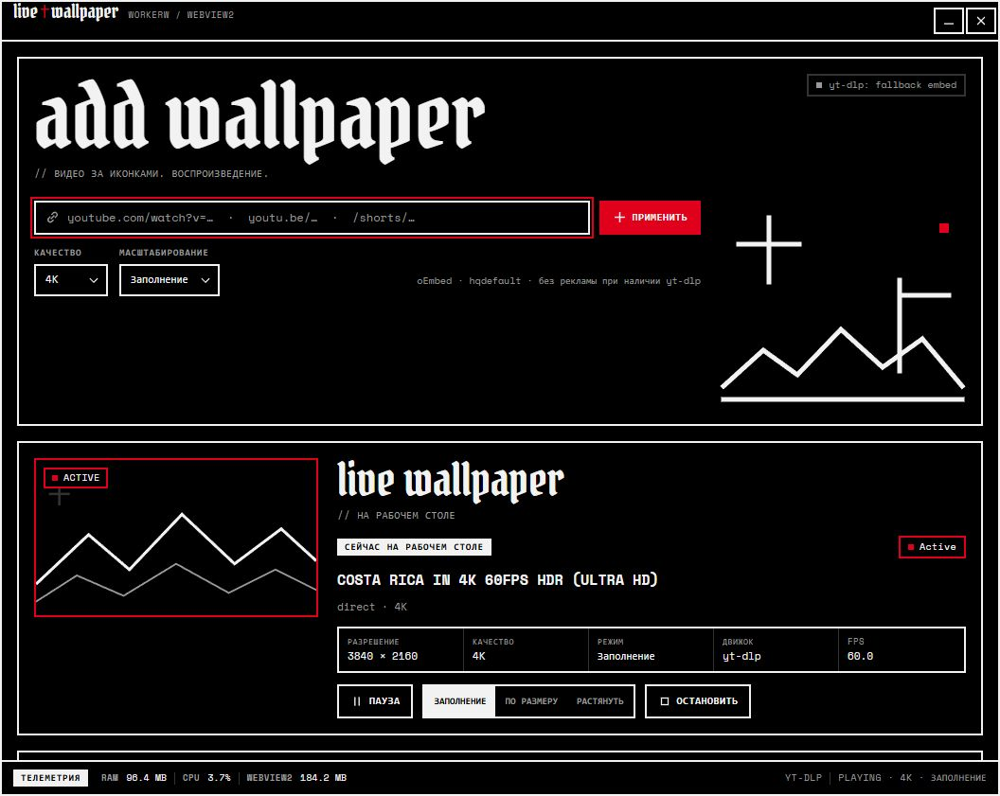
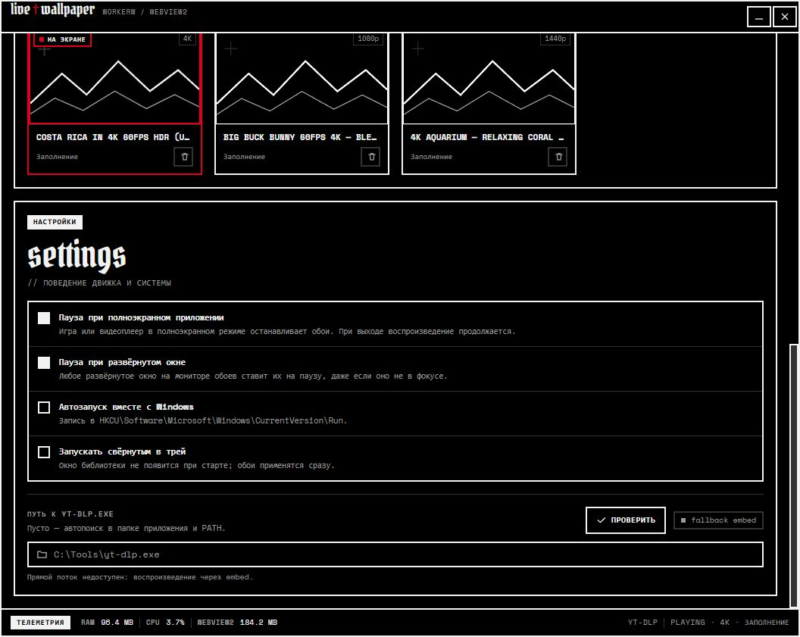

# yt-live-wallpaper

Живые обои для Windows 10/11: YouTube-видео проигрывается **за иконками рабочего
стола**, поверх системного фона, без окон и панелей. Написано на Rust + Tauri v2 +
WebView2, интерфейс — vanilla HTML/CSS/JS без сборщика и зависимостей.

<p align="left">
  
  
  
</p>

---

## Скриншоты





## Интерфейс

Окно приложения оформлено в теме «black metal / zine»: чистый чёрный фон,
жёсткие 2 px рамки без скруглений, моноширинный текст и один красный акцент.
Палитра определена только переменными в `src/styles.css`: `--bg`, `--fg`,
`--dim`, `--line`, `--red`. Красный используется только для главной кнопки
«Применить», активных обоев, креста в логотипе, ошибок, фокуса с клавиатуры
и выделения текста. В остальном интерфейс чёрно-белый.

`Pirata One` идёт только на логотип и крупные заголовки латиницей (`add wallpaper`,
`live wallpaper`, `library`, `settings`). Под каждым заголовком — русская подпись
в `Space Mono` заглавными. Остальной текст, включая кириллицу, — `Space Mono`
с fallback на Consolas: в обоих шрифтах кириллицы нет.

Файлы шрифтов лежат в `src/ui/fonts/`, лицензия — `src/ui/fonts/OFL.txt`.
Сеть для загрузки шрифтов не используется.

## Что умеет

- **Обои за иконками.** Отдельное окно WebView2 встраивается в `WorkerW` оболочки
  Windows и остаётся под слоем `SHELLDLL_DefView`, поэтому ярлыки рабочего стола
  видны и кликабельны поверх видео. Поддерживаются классический layout и Windows 11
  24H2+, где `SHELLDLL_DefView` может находиться внутри `Progman`.
- **Локальная библиотека.** Ссылка → `VIDEO_ID` → метаданные через oEmbed →
  миниатюра `hqdefault.jpg`. Всё хранится в `library.json`, ничего не уходит на
  сторонние серверы, кроме самого YouTube.
- **Два движка.** Прямой поток через `yt-dlp` (качество Auto/4K/1440p/1080p,
  без звука, бесшовный цикл) и автоматический fallback на YouTube IFrame API,
  если `yt-dlp` не найден, вернул ошибку или поток не играет. Embed запускается
  без кнопок YouTube и поверх него есть прозрачный щиток от мыши. Окно обоев
  показывается только после события `PLAYING` + 300 мс; на паузе сначала прячется.
  Выбранный движок и причина fallback пишутся в `engine.log` и телеметрию.
- **Умная пауза.** Фоновый поток раз в ~700 мс проверяет окна на мониторе обоев:
  полноэкранное foreground-приложение либо любое развёрнутое/почти полноэкранное
  окно ставит воспроизведение на паузу, даже если оно не в фокусе. Состояние
  меняется только после двух совпадающих проверок подряд. Собственные окна,
  `Progman/WorkerW/SHELLDLL_DefView/SysListView32`, панель задач, системные
  shell-окна и tool-окна игнорируются. Оба переключателя настраиваются отдельно.
- **Трей.** Закрытие окна прячет его в трей, обои продолжают работать. Меню:
  «Открыть библиотеку», «Пауза / Возобновить», «Остановить обои», «Выход».
- **Телеметрия.** RAM процесса и всех дочерних `msedgewebview2.exe`, CPU, режим
  воспроизведения — раз в 2 секунды, моноширинным шрифтом.
- **Автозапуск.** Запись в `HKCU\Software\Microsoft\Windows\CurrentVersion\Run`
  с ключом `--minimized`.

---

## Как это работает

### 1. WorkerW: обои под иконками

Стандартный приём из мира Wallpaper Engine, адаптированный под Windows 11:

1. Находим окно `Progman`.
2. Отправляем `SendMessageTimeoutW(Progman, 0x052C, WPARAM(0xD), LPARAM(0x1), SMTO_NORMAL, 1000, ...)`, чтобы Explorer создал/обновил слой для обоев.
3. Перебираем `EnumWindows` и ищем окно, внутри которого есть `SHELLDLL_DefView` (слой иконок рабочего стола).
4. Если `SHELLDLL_DefView` находится внутри `Progman` (типично для Windows 11 24H2+) — хостом обоев становится дочерний `WorkerW` внутри `Progman`. В классическом layout хостом становится следующий top-level `WorkerW` после окна, содержащего `SHELLDLL_DefView`.
5. `SetParent(wallpaper_hwnd, workerw)`, переводим окно в `WS_CHILD`, ставим `WS_EX_TOOLWINDOW | WS_EX_NOACTIVATE | WS_EX_TRANSPARENT`, затем `SetWindowPos(HWND_BOTTOM, ..., SWP_NOACTIVATE | SWP_SHOWWINDOW | SWP_FRAMECHANGED)`. Обои остаются под иконками, а клики проходят к рабочему столу.

Ключевые файлы:

| Файл | Ответственность |
| --- | --- |
| `src-tauri/src/win32/desktop.rs` | Поиск `WorkerW`, attach/detach, размер экрана, сохранение и восстановление системных обоев. |
| `src-tauri/src/runtime.rs` | Жизненный цикл окна `wallpaper`, применение/остановка/пауза, фоновые потоки. |
| `src-tauri/src/win32/power.rs` | Определение полноэкранного и развёрнутого окна, покрывающего монитор обоев. |
| `src-tauri/src/win32/stats.rs` | RAM/CPU по дереву процессов. |

Перед первым применением обоев текущий системный фон сохраняется через
`SPI_GETDESKWALLPAPER`. При остановке он возвращается через
`SPI_SETDESKWALLPAPER` + `SPIF_UPDATEINIFILE | SPIF_SENDCHANGE`.

Если `WorkerW` создать не удалось (нестандартная оболочка, Explorer перезапущен),
окно показывается обычным верхним окном без рамки — обои остаются видимыми, но
поверх иконок. Повторное применение или перезапуск приложения возвращает
нормальный режим.

### 2. Воспроизведение

**Прямой режим (`yt-dlp`).** Бэкенд запускает `yt-dlp -J` с таймаутом и выбирает
**video-only** поток (звук не нужен и только мешает):

```
bestvideo[height<=H][vcodec^=avc1]/bestvideo[height<=H]/best[height<=H]
```

H.264 (`avc1`) предпочтителен, потому что WebView2/Media Foundation декодирует
его аппаратно почти на любом железе. Страница `wallpaper.html` играет поток в
двух стековых `<video muted>`: второе видео подгружается за ~1.7 с до конца и
переключается через `opacity`, поэтому цикла не видно. Короткие ролики (< 6 с)
зацикливаются нативно через `loop`.

**Fallback (IFrame API).** Если `yt-dlp` не найден, вернул ошибку или поток
отдал `error` (частые протухшие URL), страница сообщает бэкенду через
`stream_failed`, и тот переключает воспроизведение на embed. В embed-режиме
`onStateChange === ENDED` вызывает `seekTo(0)` + `playVideo()` — получается
бесшовный цикл, как у обычных обоев.

При каждом выборе движка в `engine.log` добавляется строка с режимом и причиной,
например `engine=embed reason=yt-dlp не найден (папка приложения и PATH)`.
Та же причина видна в подсказке поля «Движок» и в телеметрии внизу окна.
Окно обоев скрыто до `PLAYING` + 300 мс и при паузе скрывается до вызова
`pauseVideo()`, поэтому стартовые/паузные элементы управления YouTube не видны.

Тип встраивания (`object-fit`) — `cover`, `contain` или `fill`; для embed
`cover` реализован геометрией iframe (он всегда больше вьюпорта, лишний UI
YouTube обрезается).

### 3. Умная пауза

Поток `power_worker` каждые ~700 мс:

1. Проверяет `GetForegroundWindow` на полноэкранный режим (допуск 2 px по `rcMonitor`).
2. Через `EnumWindows` перебирает все видимые top-level окна на мониторе обоев. Игнорируются собственные HWND и PID, свёрнутые/cloaked окна, `WS_EX_TOOLWINDOW`, shell-классы (`Progman`, `WorkerW`, `SHELLDLL_DefView`, `SysListView32`, `Shell_TrayWnd`, `Shell_SecondaryTrayWnd`, `Windows.UI.Core.CoreWindow` и др.).
3. Пауза, если `IsZoomed` либо пересечение `GetWindowRect` с `rcWork` монитора ≥95%. Фон не важен: развёрнутое окно за другим окном тоже скрывает обои.
4. Новое состояние фиксируется только после двух подряд совпадающих проверок, затем эмитится `wallpaper:pause` с причиной `fullscreen` или `maximized`.

Важно: при умной паузе окно обоев **не закрывается и не уничтожается** — останавливается только воспроизведение (`video.pause()` / `player.pauseVideo()`), поэтому возврат происходит мгновенно. Ручная пауза и автоматическая независимы.

### 4. Потоки и состояние

- `state:changed` — новое состояние `Playback` (плеер, качество, FPS, разрешение).
- `library:changed` — обновлённая библиотека.
- `ytdlp:changed` — результат поиска `yt-dlp`.
- `wallpaper:play` / `wallpaper:pause` / `wallpaper:fit` / `wallpaper:stop` —
  команды странице обоев; `wallpaper_playing` — обратная команда после
  `PLAYING` + 300 мс, разрешающая показывать окно.
- `note` — необязательный тост.

Страница обоев при загрузке сама вызывает `get_playback`, потому что событие
`wallpaper:play` может прийти раньше, чем WebView2 закончит навигацию.

---

## Структура проекта

```
yt-live-wallpaper/
├─ AGENTS.md                 # обязательные правила UI (Unslop)
├─ package.json              # только CLI Tauri, без зависимостей фронтенда
├─ README.md
├─ src/                      # фронтенд, отдаётся Tauri как есть
│  ├─ index.html             # окно библиотеки (960×640)
│  ├─ styles.css             # палитра, шрифты, панели, карточки, тосты
│  ├─ app.js                 # команды, события, поиск, телеметрия, demo-режим
│  ├─ ui/fonts/              # Pirata One и Space Mono (woff2 + OFL.txt)
│  ├─ wallpaper.html         # страница обоев (без интерфейса)
│  ├─ wallpaper.css
│  └─ wallpaper.js           # direct + embed, кроссфейд, FPS
└─ src-tauri/
   ├─ Cargo.toml
   ├─ tauri.conf.json
   ├─ capabilities/default.json
   ├─ icons/
   │  ├─ icon-source.svg     # исходник иконки: чёрный квадрат, белый крест
   │  └─ icon-1024.png       # PNG для tauri icon
   └─ src/
      ├─ main.rs             # точка входа
      ├─ lib.rs              # builder, setup, tray, RunEvent::Exit
      ├─ model.rs            # Settings, WallpaperEntry, Playback, Telemetry
      ├─ storage.rs          # app_data_dir, атомарная запись JSON
      ├─ library.rs          # парсинг ссылок, oEmbed, новая запись
      ├─ ytdlp.rs            # поиск бинарника, -J, выбор потока
      ├─ autostart.rs        # HKCU Run
      ├─ commands.rs         # все #[tauri::command]
      ├─ runtime.rs          # окно, apply/stop/pause, workers
      ├─ tray.rs             # меню трея
      └─ win32/
         ├─ desktop.rs       # WorkerW + обои Windows
         ├─ power.rs         # fullscreen detection
         └─ stats.rs         # RAM/CPU телеметрия
```

### Данные

`%APPDATA%\com.ytlivewallpaper.desktop\`:

- `library.json` — массив записей:
  `id`, `video_id`, `url`, `title`, `thumbnail_url`, `quality`, `fit_mode`,
  `added_at`, `last_used_at`, `channel` (необязательный).
- `settings.json` — `pauseFullscreen`, `pauseMaximized`, `autostart`,
  `startMinimized`, `ytdlpPath`, `quality`, `fit`. Старый ключ `smartPause`
  при чтении превращается в `pauseFullscreen`.
- `engine.log` — журнал выбора движка: найден ли `yt-dlp`, ошибка/resolve,
  принудительный fallback, итоговый режим и причина.

Запись атомарная: временный файл + `rename`, чтобы падение не портило библиотеку.

---

## Требования

- Windows 10 21H2+ или Windows 11.
- WebView2 Runtime (на Win11 уже есть; установщик умеет скачивать bootstrapper).
- Rust 1.77.2+ с тулчейном MSVC и Visual Studio Build Tools (C++).
- **Node.js не обязателен** — сборщика нет, Tauri отдаёт `src/` напрямую.
- `yt-dlp.exe` — опционально, но именно он даёт 1440p/4K и прямой поток.

## Сборка и запуск

```powershell
# проверка типов
cargo check --manifest-path src-tauri/Cargo.toml

# clippy как в CI
cargo clippy --manifest-path src-tauri/Cargo.toml -- -D warnings

# запуск в dev-режиме (без Node)
cargo run --manifest-path src-tauri/Cargo.toml

# релизный NSIS-установщик
cargo install tauri-cli --version "^2" --locked   # один раз
cargo tauri build
```

Если установлен Node.js, те же шаги доступны через `npm run check`,
`npm run clippy`, `npm run dev`, `npm run build`.

### yt-dlp

1. Скачайте `yt-dlp.exe` с [github.com/yt-dlp/yt-dlp/releases](https://github.com/yt-dlp/yt-dlp/releases).
2. Положите рядом с приложением **или** укажите полный путь в
   «Настройки → yt-dlp».
3. Нажмите «Проверить» — приложение покажет версию и статус.

Без `yt-dlp` всё работает через embed, но максимум качества и стабильность
цикла будут хуже.

---

## Ограничения

- **Только Windows.** WorkerW, `SPI_SETDESKWALLPAPER` и телеметрия — Win32.
- **Только YouTube.** Парсер понимает `watch`, `youtu.be`, `shorts`, `embed`,
  `live`; остальные ссылки отклоняются до сети.
- **Один монитор.** Окно обоев растягивается на основной монитор; на
  мультимониторных конфигурациях второй экран остаётся со статичным фоном.
- **Звука нет.** Обои всегда беззвучные — это осознанное решение.
- **Ссылки `yt-dlp` живут несколько часов.** Поток перезапрашивается при смене
  трека, качества или после ошибки; долгие сессии могут один раз мигнуть
  fallback'ом.
- **DRM/платные видео** не поддерживаются ни одним из движков.
- **Explorer может перезапуститься** (обновление, краш) — окно потеряет
  родителя. Помогает повторное «Применить» или перезапуск приложения.
- **Антивирус** может ругаться на `yt-dlp` и автозапуск через Run-ключ.

## Диагностика

| Симптом | Что делать |
| --- | --- |
| Обои поверх иконок | Explorer не создал `WorkerW`. Перезапустите Explorer или примените обои повторно. |
| Чёрный экран, статус `Active` | `yt-dlp` отдал протухший URL. Подождите авто-перезапрос или смените качество. |
| Нет 4K | Видео не имеет 4K, либо выбран `1080p`. Поставьте `Auto` и проверьте `yt-dlp -F <url>`. |
| Не запускается автозапуск | Проверьте `HKCU\Software\Microsoft\Windows\CurrentVersion\Run` → `YtLiveWallpaper`. |
| Высокий CPU | Ограничьте качество до `1080p`; 4K на слабом GPU декодируется программно. |
| Окно не открывается из трея | Второй экземпляр блокируется `single-instance` и поднимает первый. |

---

## Credits

- [Pirata One](https://fonts.google.com/specimen/Pirata+One) — Rodrigo Fuenzalida,
  Nicolas Massi. Лицензия SIL OFL 1.1.
- [Space Mono](https://fonts.google.com/specimen/Space+Mono) — The Space Mono
  Project Authors. Лицензия SIL OFL 1.1.

Обе лицензии включены в `src/ui/fonts/OFL.txt`.

## Лицензия

MIT. Проект не аффилирован с YouTube; соблюдайте условия сервиса и права
авторов видео.
